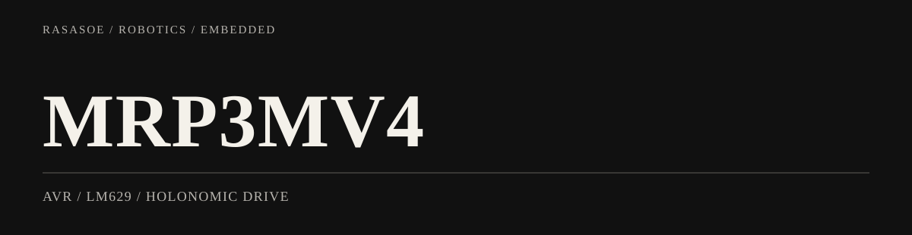

<picture>
  <source media="(max-width: 600px)" srcset="assets/portfolio-banner-mobile.svg">
  
</picture>

<p align="right"><a href="README.md">한국어</a> / <strong>English</strong></p>

# MRP3MV4 — AVR Holonomic Robot Platform

**Robotics progression 01 / 03 · AVR · LM629 · PSD sensors**

This project introduced the connection between **distance sensing, embedded control, and real three-wheel motion** using an AVR/LM629-based platform. It provided the foundation for a later Pico encoder-control experiment (AMR) and the ROS 2 BuddyBot integration.

## Engineering experience

- Three-wheel holonomic motion and demonstration modes
- PSD distance-sensor input for obstacle response
- AVR firmware control flow, button-triggered tasks, motor behavior
- Next step: implement speed feedback and proportional control directly on Pico

## Real hardware demonstration

<p align="center"><a href="docs/videos/demo.mp4"></a></p>

[Original video](docs/videos/demo.mp4) · [AMR](https://github.com/rasasoe/AMR) · [BuddyBot](https://github.com/rasasoe/BuddyBot)

---

## Overview

**MRP3MV4** is an educational/research mobile robot based on a holonomic drivetrain and AVR firmware. It explores basic motion control and sensor-driven demonstrations.

**Main capabilities described in the repository:**
- Three-wheel holonomic motion with LM629-based motor control.
- Obstacle avoidance and distance keeping using PSD sensors.
- Optional line following and camera tracking demonstration modules.
- Hardware push-button selection of demo/task modes.

## Hardware

| Category | Configuration |
| --- | --- |
| Microcontroller | AVR family, firmware references 16 MHz clock |
| Motor controller | Three channels of LM629 |
| Sensors | PSD range/proximity, IR/optical; optional camera |
| Interfaces | LCD, push buttons, buzzer; optional Bluetooth |

## Source code

- `src/main.c`: initialization and entry into demo/task logic.
- `src/DEMO.c`: numbered DEMO and TASK routines.
- `src/`: firmware C sources.
- `include/`: headers.
- `docs/images/`, `docs/videos/`: demonstration assets.

## Build notes

A suitable AVR toolchain is required. The exact `-mmcu` target and programmer must match your physical board; the repository does not establish one universal flashing command for every hardware revision.

Example structure:

```bash
avr-gcc -mmcu=YOUR_MCU -DF_CPU=16000000UL -Iinclude -Os -std=gnu11 src/*.c -o firmware.elf
avr-objcopy -O ihex firmware.elf firmware.hex
```

## Next step in the learning progression

[MRP3MV4](https://github.com/rasasoe/MRP3MV4) → [AMR](https://github.com/rasasoe/AMR) → [BuddyBot](https://github.com/rasasoe/BuddyBot)

These are separate codebases illustrating a progression of robot control concepts, not different releases of a single repository.

**[한국어 README](README.md)** contains the original hands-on instructions and source description.

---

*MRP3MV4 · Embedded C / Educational Robotics*
