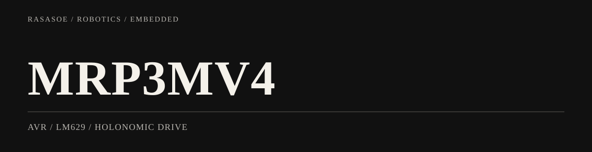

<picture>
  <source media="(max-width: 600px)" srcset="assets/portfolio-banner-mobile.svg">
  
</picture>

<p align="right"><strong>한국어</strong> / <a href="README.en.md">English</a></p>

# MRP3MV4 — AVR 기반 3륜 홀로노믹 로봇

**로봇 개발 경험 01 / 03 · AVR · LM629 · PSD 센서**

이 프로젝트에서는 AVR·LM629 기반의 로봇 구동 플랫폼을 사용해 **센서 입력이 실제 주행 동작으로 연결되는 과정**을 익혔습니다. 이후 직접 피드백 제어를 구현한 AMR, 그리고 ROS 2 기반 BuddyBot으로 경험을 확장했습니다.

## 직접 다룬 내용

- **주행:** 세 바퀴 홀로노믹 구동과 이동·회전 데모
- **센서:** PSD 거리 센서를 통한 근접 물체 감지와 회피·거리 유지 동작
- **제어:** AVR 펌웨어의 데모·태스크 모드, 스위치 입력과 구동 동작
- **다음 단계:** 보드의 기존 제어 기능을 활용하던 경험을 바탕으로, Pico에서 엔코더 피드백과 P제어를 직접 구현

## 실물 시연

<p align="center"><a href="docs/videos/demo.mp4"></a></p>

[원본 주행 영상](docs/videos/demo.mp4) · [AMR — 다음 개발 경험](https://github.com/rasasoe/AMR) · [BuddyBot — 최종 통합 프로젝트](https://github.com/rasasoe/BuddyBot)

---

## 프로젝트 개요 ✨
**MRP3MV4**는 홀로노믹 구동 플랫폼을 기반으로 한 교육/연구용 모바일 로봇입니다. 이 저장소는 AVR 기반 펌웨어 (모터 제어, 센서 읽기, 데모/태스크 모드 등)를 포함하고 있으며 주 기능은 다음과 같습니다:

- 3륜 홀로노믹 주행 (LM629 기반 모터 제어)
- PSD(근접/거리) 센서를 이용한 장애물 회피 및 거리 유지
- 라인 트래킹, 카메라 기반 추적(선택적 모듈) 데모
- 데모/태스크 선택: SW1/SW2/SW3 버튼으로 작동

---

## 하드웨어 요약 ⚙️
- MCU: AVR 계열 (소스에 AVR 헤더 사용, F_CPU = 16MHz)
- 모터 드라이버: LM629 (3채널)
- 센서: PSD(거리), IR/광센서, 선택적 카메라 모듈
- 인터페이스: LCD 출력, 스위치(SW1/SW2/SW3), 부저, 블루투스(선택)

---

## 폴더 구조 (변경됨) 📁
프로젝트를 더 표준화하기 위해 다음과 같이 변경했습니다:

- `src/` ← 이전 `C/` (펌웨어 C 소스 코드)
- `include/` ← 이전 `Header/` (헤더 파일)
- `docs/images/` (로봇 사진/문서용 이미지)

권장 빌드 방식:
- 컴파일러: avr-gcc
- 헤더 인클루드 플래그: `-Iinclude`
- 예시: `avr-gcc -mmcu=<MCU> -DF_CPU=16000000UL -Iinclude -Os -std=gnu11 src/*.c -o firmware.elf`

> 주의: 실제 MCU 이름(예: atmega128 등)은 보드/보드 정의를 확인해 `-mmcu`에 맞춰 설정하세요.

---

## 사용 방법 (데모/테스트) ▶️
- 전원 ON
- SW1: DEMO 모드로 진입 (데모 번호 선택 후 SW2로 실행)
- SW3: TASK 모드로 진입 (태스크 번호 선택 후 SW2로 실행)
- DEMO 예시: DEMO5는 PSD 기반 장애물 회피(앞→후진→회전)
- reset 버튼: 현재 모드 정지 및 초기 메뉴로 복귀

---

## 빌드 및 플래시(권장) 🔧
1. 툴체인 설치: `avr-gcc`, `avrdude` 또는 사용 중인 플래시 툴
2. 컴파일 예시:

```bash
avr-gcc -mmcu=<MCU> -DF_CPU=16000000UL -Iinclude -Os -std=gnu11 src/*.c -o mrp3mv4.elf
avr-objcopy -O ihex mrp3mv4.elf mrp3mv4.hex
```

3. 플래시 예시 (`avrdude`):

```bash
avrdude -c <programmer> -p <mcu> -U flash:w:mrp3mv4.hex
```

(구체적 명령은 사용 중인 보드/프로그래머에 따라 달라집니다.)

---

## 코드 개요 및 주요 파일 🔍
- `src/main.c` : 시스템 초기화 및 `Demo_main()` 진입점
- `src/DEMO.c`: 데모 및 태스크 정의 (DEMO1..DEMO7, TASK1..TASK6)
- `src/Motor.c`, `src/Move.c`: 모터 제어, 홀로노믹 동작
- `src/Sensor.c`: PSD/카메라/센서 인터페이스
- `include/*.h`: 각 모듈의 헤더 정의

---

## 변경 내용(이번 커밋) ✅
- `C/` → `src/`, `Header/` → `include/`로 폴더명 변경
- `docs/images/` 디렉토리 추가 (로봇 사진 보관용)
- README를 프로젝트 전반을 설명하도록 상세화

---

## 사진 및 동영상 추가 안내 📸🎥
필요 시 사진/동영상 자료는 `docs/images/` 및 `docs/videos/`에 추가해 주세요.

---

## 기여 및 연락 💬
- 이 저장소는 교육/연구용으로 사용됩니다. 개선사항/버그는 이슈로 제시해 주세요.
- 주요 변경(예: 보드 설정, Makefile 추가 등)이 필요하면 알려주세요.

---

> 추가로 원하시면 자동 빌드용 `Makefile`과 `CONTRIBUTING.md`를 만들어 드리겠습니다. 사진 올려주면 README에 포함하겠습니다. 🔧
